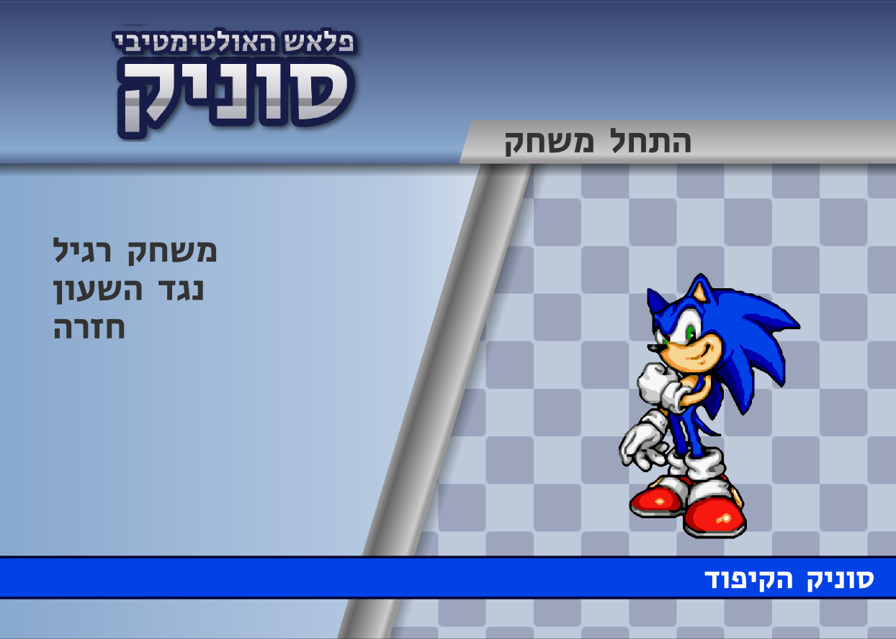
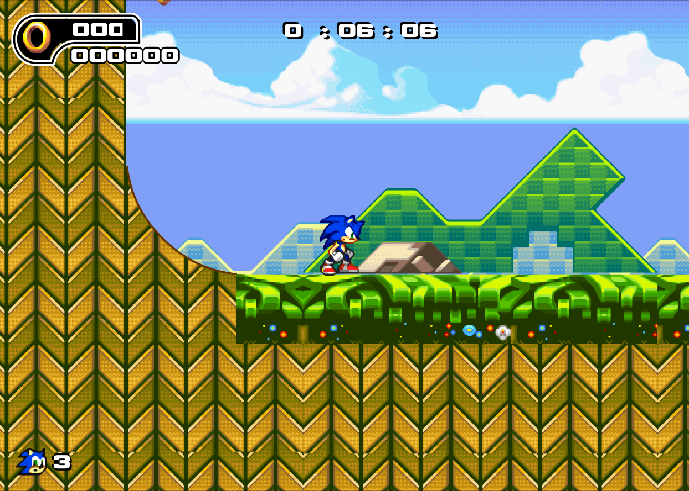

# סוניק פלאש האולטימטיבי — בעברית

תרגום מלא לעברית של משחק המעריצים **Ultimate Flash Sonic**, עם גרפיקה מוגדלת (xBRZ ×6) למסכי 4K/8K, גרסת דפדפן לטלפון ולמחשב, וקובץ EXE יחיד ל-Windows.

**▶ לשחק בדפדפן:** https://dor2500.github.io/sonic-flash-he/

**⬇ הורדה ל-Windows:** [Releases](https://github.com/dor2500/sonic-flash-he/releases/latest) → `sonic_flash_he.exe` (לא צריך התקנה)




## מקשים
| פעולה | מקלדת | טלפון |
|---|---|---|
| תזוזה | חיצים ימינה / שמאלה | ◀ ▶ |
| קפיצה | רווח | קפיצה |
| ספין-דאש | למטה + רווח, ואז לשחרר | ▼ + קפיצה |
| השהיה | אנטר | II |

בטלפון: נגיעה במסך = לחיצת עכבר בתפריטים; 🎮 מציג/מסתיר כפתורים, ⛶ מסך מלא.

## מה יש בפנים
- כל הטקסטים, התפריטים, השמות והלוגו בעברית (Flash הקלאסי בלי bidi — הטקסט נשמר בסדר חזותי).
- כל ה-bitmaps מוגדלים פי 6 ב-xBRZ; וקטורים וטקסט חדים בכל רזולוציה.
- במסך מלא / חלון מוגדל: הבמה ממורכזת ומחוץ לה שחור (בנגן המקורי נראו אובייקטים מחוץ לבמה).
- גרסת דפדפן על [Ruffle](https://ruffle.rs) (אמולטור Flash בקוד פתוח), כפתורי מגע, PWA.

## בנייה
דרוש: Windows, Java (JDK 17+), Python 3 + Pillow, ‏`xbrz_cli.exe` ב-`work\bin`.
שמים ב-`orig\` את `Ultimate Flash Sonic.swf`, ‏`flashplayer_32_sa.exe` ו-`icon.ico`, ואז:

```powershell
.\build.ps1              # -> output\סוניק פלאש.exe + output\Ultimate Flash Sonic HE.swf
.\tools\build_web.ps1    # -> output\web + output\sonic_flash_he_web.zip
```

| קובץ | תפקיד |
|---|---|
| `tools/translate.py` | כל התרגומים, פריסת טקסט סטטי, תיקוני סקריפטים (ActionScript) |
| `tools/HeTool.java` | גליפים עבריים בגופנים, טקסטים, SWF v6/UTF-8, החלפת bitmaps ל-HD |
| `tools/hd_images.py` | הגדלת כל התמונות ב-xBRZ |
| `tools/make_logo.py` | הלוגו העברי |
| `tools/set_icon.py` | אייקון ל-projector |
| `tools/build_web.ps1` | גרסת הדפדפן |
| `tools/shot.ps1` | בדיקה: הפעלה, לחיצות ומקשים, צילום מסך |

כלים: [JPEXS FFDec](https://github.com/jindrapetrik/jpexs-decompiler), ‏[xBRZ](https://sourceforge.net/projects/xbrz/), ‏[Ruffle](https://ruffle.rs). גופנים: Rubik, Secular One, Suez One, Fredoka (SIL OFL).

## זכויות
Sonic the Hedgehog והדמויות שייכים ל-SEGA. ‏Ultimate Flash Sonic הוא משחק מעריצים חינמי של יוצריו המקוריים. המאגר מכיל רק את כלי התרגום; קבצי המשחק עצמם מופצים רק כקבצי Release, ללא מטרות רווח.
